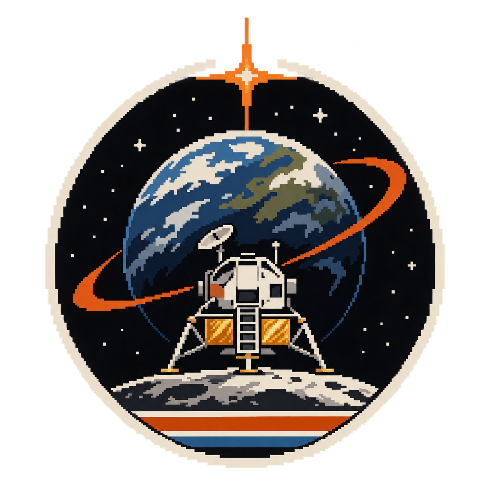

# Final Orbit

A pixel-art space game for foldable phones. You fly missions for a space agency through a star system with real orbital physics, in ships that break apart when they crash.

**Status:** in active development.

## Highlights

- **Real orbital physics,** running on a custom physics engine written in C++.
- **Ships made of pixels.** Every piece has weight, and damage changes how the ship flies.
- **Built for foldable phones.** Fold or unfold mid-flight without losing your place.
- **Landings, atmospheric entry and a space station** to fly between.
- **Backed by automated tests.**

## Built with

Godot · GDScript · C++

## Run it

1. Build the physics core once (see [native/README.md](native/README.md)).
2. Open `project.godot` in Godot 4.7 and press Play.

The full design, including what's planned for later tiers, is in [docs/DESIGN.md](docs/DESIGN.md).
